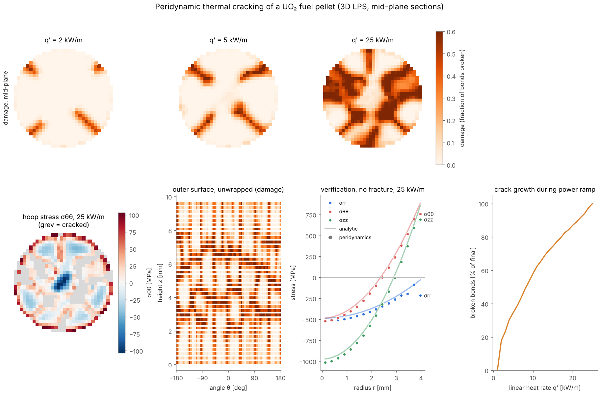

# pellet-pd — peridynamic thermal cracking of UO₂ fuel pellets

A high-performance, single-file C++17/OpenMP **state-based peridynamics** solver for thermal cracking of nuclear fuel pellets and pellet stacks, plus a complete study toolkit:

* mesh convergence on crack area;
* the effect of the Weibull strength distribution;
* a parametric campaign feeding **PySR** symbolic regression of fragment size;
* a high-resolution production run;
* sympathetic cracking between stacked pellets.

Everything runs locally or as Spot-VM task arrays on Google Cloud Batch, with outputs organised in a versioned Cloud Storage layout. Planners default to a **lean** profile, run in the cheapest Spot region: about $36 for the whole programme at current prices, against about $220 for the full designs (DESIGN.md §6).

**Start with [DESIGN.md](DESIGN.md)**: questions, model, the strength-vs-energy calibration decision, every study's design and gates, the data layout, cloud plan, cost estimates and limitations.

> Status: the solver and all tools compile, lint and dry-run cleanly. Kernels shared with v1 were verified against the analytic thermoelastic solution. **The v2 studies themselves have not been run yet.**

## Results so far (version 1)

These come from the **v1 solver** ([`v1/pellet_pd_v1.cpp`](v1/pellet_pd_v1.cpp)), the single-pellet predecessor of v2. v2 shares its force, fracture-cycle and stress-recovery kernels, but adds creep, stacks, contact, restarts and labelled outputs. They are a demonstration at coarse resolution, not converged results.



**Setup.**
* Full-size pellet (R = 4.1 mm, H ≈ 9.7 mm), 16 particles across the radius: 30,856 particles and 4.9 M bonds.
* G_c-calibrated critical stretch with per-bond Weibull scatter (m = 12).
* Linear heat rate ramped from 0 to 25 kW/m in 25 steps, with no creep.
* Run time: 16 min on 2 CPU cores, at about 450 M bond evaluations per second.

**What the panels show.**
* **Top row:** mid-plane damage.
  * Four radial cracks open at about 2 kW/m.
  * By 5 kW/m they have run inward and arrested near mid-radius, where the hot core is in compression.
  * By 25 kW/m additional cracks and branches have fragmented the pellet.
* **Bottom left:** hoop stress at 25 kW/m.
  * Cracking has relieved the stress to about ±100 MPa, compared with the ~850 MPa elastic surface hoop stress of an uncracked pellet.
  * Grey marks crack debris, where stress is not reported.
* **Bottom, second:** the outer surface unrolled (angle × height).
  * The radial cracks run along the full pellet height.
* **Bottom, third: verification without fracture.**
  * Mid-plane stresses against the analytic long-cylinder thermoelastic solution.
  * Hoop-stress RMS error falls with refinement: 6.4 % → 4.5 % → 4.4 % for 8 → 12 → 16 particles across the radius.
  * The remaining gap sits in the outermost particle layer: the known peridynamic surface effect.
* **Bottom right:** cumulative broken bonds during the power ramp.

**Limitations of these v1 results.**
* The resolution is coarse, so the lattice gives cracks a mild 45°/90° preference.
* Crack initiation power depends on the horizon size when s_c comes from G_c. This is the calibration issue v2's mesh-convergence study addresses (DESIGN.md §3).
* The crack-debris stress mask in the figure was applied in post-processing using the rule that v2 now applies in the solver.

## Repository

| File | Purpose |
|------|---------|
| `pellet_pd.cpp` | Solver. LPS with thermal strain, Weibull grain-field strength, viscoelastic creep, sequential critical-bond breaking, crack-face contact, multi-body stacks with friction, restart and checkpoint, labelled outputs. `./pellet_pd --help` |
| `build.sh` | Build with the source hash embedded as the build id. |
| `pdio.py` | Readers for every output format (state dumps, restart headers, run directories, histories). |
| `schema.py` | Data dictionary: every file and column with units. `python schema.py > schema.json` |
| `crackmesh.py` | Crack-aware visualiser. Projects particle fields onto a hex mesh, deletes every cell a crack passes through, labels fragments, extracts crack faces. Writes VTU/VTP, CSV and JSON, and PNGs with `--render`. |
| `study_common.py` | Cases, job files (local / Slurm / Cloud Batch), run catalogue with checksums, labelled derived tables, `gcloud storage` sync. |
| `config.py` | UO₂ defaults, calibration record, standard histories, cost model. |
| `bench.py` | Cloud machine-type benchmark (price per 10¹² bond evaluations). |
| `mesh_convergence.py` | m- and δ-refinement in both calibration modes, GCI, writes the calibration. |
| `weibull_study.py` | Weibull modulus × correlation length × seeds, two scenarios. |
| `campaign.py` | Sobol design over geometry, material distributions and cycle histories, then the dataset. |
| `features.py` | Dimensionless features and targets, shared by the dataset, the fit and the predictor. |
| `fit_pysr.py` | PySR 2.x fit, held-out validation, Occam selection, model cards. |
| `predict_fragments.py` | Fragment-size estimate from a user's history, geometry and material. |
| `highres.py` | Hero run plus the reference cracked pellet (restart) for the stack study. |
| `stack_study.py` | Half/cracked/half stack: pressure × friction × contact area, with intact controls. |
| `cloud/` | `task.sh` (Spot-safe Batch task), `Dockerfile`, `lifecycle.json`, `requirements.txt`. |

## Quick start (local)

```bash
./build.sh
./pellet_pd --elastic --steps 1 --nr 12 --H 0.02 --out check   # verification vs analytic solution
./pellet_pd --nr 16 --sigmaf 130e6 --wcorr 0.25e-3 --steps 25 --out demo
python crackmesh.py demo/state_*.bin --warp 30                   # crack-aware meshes for ParaView
```

## Workflow

```bash
pip install -r cloud/requirements.txt
python bench.py plan --bucket B --image IMG          # Q1: then submit jobs/batch_job_<machine>.json
python mesh_convergence.py plan --bucket B --image IMG
python study_common.py push studies/meshconv --bucket B --execute
gcloud batch jobs submit meshconv-1 --location us-central1 --config studies/meshconv/jobs/batch_job.json
python study_common.py pull studies/meshconv --bucket B --study meshconv --execute
python mesh_convergence.py analyze studies/meshconv && python mesh_convergence.py plot studies/meshconv
python weibull_study.py plan --with-cycle ...         # same plan / push / submit / pull / analyze / plot cycle
python campaign.py plan ... ; python campaign.py collect studies/campaign-A
python fit_pysr.py studies/campaign-A --learning-curve   # only if it says EXTEND:
python campaign.py plan --extend                          # +128/+32 runs, same Sobol sequence
python fit_pysr.py studies/campaign-A
python predict_fragments.py --history my_cycles.txt --R 4.1e-3 --H 9.8e-3 \
    --model studies/campaign-A/derived/pysr/model_log10_nfrag.json
python highres.py plan ... ; python highres.py post studies/highres --render
python stack_study.py plan --restart studies/highres/runs/<stackref>/restart.bin --design oat
python stack_study.py analyze studies/stack && python stack_study.py plot studies/stack
```

Any planned study also runs locally: `python study_common.py run <study> --parallel 2 --threads 8`. This is resumable, and complete runs are skipped. `python study_common.py catalog <study>` indexes runs with their status and checksums.

## Outputs

Every run directory contains:

* `manifest.json`: inputs, derived values, schedule, build id, labels;
* `history.csv`: about 40 columns per load step;
* `cycles.csv`, `fragments.csv`;
* `profile_*`, `angular_*`, `interface_*` CSVs;
* `state_*.bin` (full fields, for `crackmesh.py`);
* `summary.json` (on completion).

Column names carry units. See `schema.py` / `schema.json`, and DESIGN.md §5 for the bucket layout.

## Licence

Not yet chosen. Add a `LICENSE` file before sharing the code or datasets.
